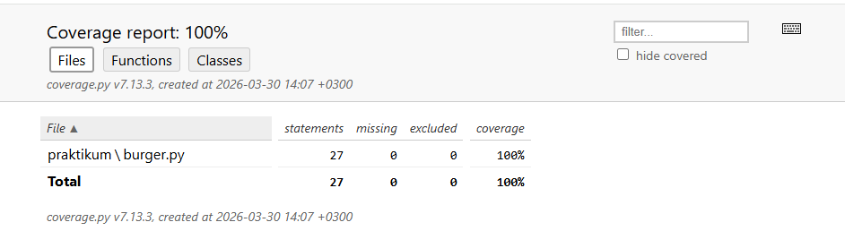

## Задание 1: Юнит-тесты

### Автотесты для проверки программы, которая помогает заказать бургер в Stellar Burgers

### Реализованные сценарии

Созданы юнит-тесты, покрывающие класс `Burger`

Процент покрытия 100% (отчет: `htmlcov/index.html`)

### Структура проекта

- `praktikum` - пакет, содержащий код программы
- `tests` - пакет, содержащий тесты, разделенные по классам - `burger_test.py`

### Запуск автотестов

**Установка зависимостей**

> `$ pip install -r requirements.txt`

**Запуск автотестов и создание HTML-отчета о покрытии**

>  `python -m pytest --cov=praktikum.burger --cov-report=html`

`python -m pytest tests/burger_test.py -v`

Исправления по замечаниям ревьюера:
Принцип «Черного ящика»: Полностью исключена проверка внутренних атрибутов (self.bun, self.ingredients, len()). Все ассерты переписаны на проверку поведения через публичные методы get_price() и get_receipt().
Атомарность тестов: Тесты разбиты на изолированные сценарии. Каждый тест проверяет одно конкретное поведение метода (влияние на цену, порядок в чеке, возникновение ошибки) без лишних промежуточных проверок состояния.
Покрытие: Достигнуто 100% покрытие кода класса Burger (отчет htmlcov сформирован, красных строк нет).
Структура: Удалены избыточные тесты для классов Bun, Ingredient и Database, оставлены только тесты для целевого класса Burger согласно требованиям задания.